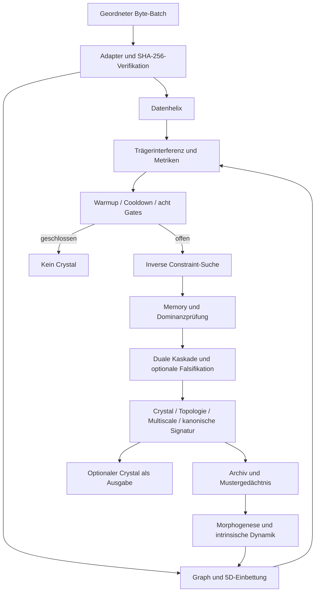

# PSE_ARCHITECTURE

## Zweck und Grenze

Die reale PSE dieses Quellstands ist eine synchrone, zustandsbehaftete Analysepipeline. Sie bildet Beobachtungen auf einen gerichteten Graphen, topologische Einbettungen und ein trägerbasiertes Resonanzmodell ab. Gates, Constraint-Extraktion, duale Operatorfolgen und optionale Surrogatprüfungen entscheiden über neue Crystals. Crystals fließen in Archiv, Mustergedächtnis und nachfolgende Graphtransformationen zurück.

Sie ist weder eine Kafka-Implementierung noch ein allgemeiner Job-Scheduler. Der schnelle Ingestion-Pfad ist nur ein Teil der Engine. Keine im Quellbestand nachgewiesene Ringbuffer-, Arena-, GPU- oder eigene SIMD-Laufzeit gehört zu diesem Ausführungspfad.

## Komponenten

| Internes Paket | Aufgabe | Direkte Engine-Abhängigkeit |
|---|---|---|
| `pse-types` | Datenmodell, Konfiguration, kanonische Bytes und Hashes | alle Schichten |
| `pse-graph` | Adapter, Digestprüfung, Graph, Beobachtungsverlauf, Tensorhistorie | L0/L1 |
| `pse-cascade` | Träger/Helix, Metriken, AND-Gate, duale Operatorfolgen | jedes Makro-Step |
| `pse-extract` | acht Referenzoperatoren, inverse Constraint-Suche | nach offenem Gate |
| `pse-evidence` | Crystal-Bau, Archiv, bestehende Teilintegritätsprüfung | Commit und Prüf-API |
| `pse-constraint` | Morphogenese, intrinsische Dynamik | nach Commit |
| `pse-topology` | Laplaceoperator, Spektrum, CTQW, Kuramoto | Crystal-Anreicherung |
| `pse-scale` | Micro/Meso/Macro-Zustände und Übergänge | Commit bis 500 Knoten |
| `pse-memory` | topologische Ähnlichkeit, kanonische Klassen, Warmstart | vor/nach Commit |
| `pse-metatron` | Graphkanonisierung, Phasengeometrie, Katalog-Unterstützung | Signatur/Memory |
| `pse-navigator` | deterministische Erkundung und Simplex-Mesh | `Engine::explore` |
| `pse-core` | Makro-Step, Kalibrierung, Falsifikation, Crystal-Operationen | Orchestrierung |
| `pse` | kleine öffentliche Fassade | Einbettungsgrenze |

Die Paketgrenzen folgen vorhandenen, separat prüfbaren mathematischen Komponenten. Es wurde keine zusätzliche Service-, Transport- oder Plugin-Schicht eingeführt. Interne Pakete sind `publish = false`; Integration erfolgt über `pse`.

## Datenfluss und Ausführung

Ein `step` verarbeitet genau einen Batch. Reihenfolge und Batchgrenzen sind semantisch relevant: gemeinsames Auftreten erzeugt Kanten; Träger, Kalibrierung und Tickzähler entwickeln sich pro Batch. Kein automatisches Umsortieren oder Zusammenlegen. Auch ein leerer Batch ist ein Tick.

Ein offenes Kairos-Gate garantiert keinen Commit: Memory-Treffer, Dominanzprüfung, Konsens oder Falsifikation können ihn verhindern. Frühabbruch durch Warmup/Cooldown kann vor der Gateberechnung erfolgen. Die öffentliche Fassade liefert dann `gate = None` statt eines alten Snapshots.

## Nebenläufigkeit

`Engine::step` verlangt `&mut self`; ein Zustand wird sequenziell verändert. Kein Tokio, Netzwerk, Hintergrundthread, Mutex oder atomischer Zähler im Makro-Step. Der Aufrufer bestimmt Eingangstakt und Backpressure. Parallelität erfolgt über unabhängige Engine-Instanzen; dies ist keine parallele Ausführung derselben Zustandsmaschine.

Eine prozessweite `OnceLock<S7Cache>` hält unveränderliche Kanonisierungsdaten. Die erste Initialisierung hat zusätzliche Laufzeit und Speicherbedarf. Rayon bleibt für die vorhandene optionale Graphkatalog-Erzeugung in der internen Memory-Unterstützung erhalten; es liegt nicht im normalen `step`-Pfad. Es gibt keinen zweiten, weniger deterministischen Durchsatzmodus.

## Speicher und Layout

Der Graph nutzt `petgraph::DiGraph`; IDs und Einbettungen liegen in `BTreeMap`s. Beobachtungen besitzen ihre Nutzdaten. Historie, Tensor-Snapshots, Hot-Tier und Crystal-Archiv bleiben bis `reset`/Drop erhalten. Warm-/Cold-Tiers sind im Original ebenfalls Speicherstrukturen, keine Datenträgerimplementierung. Retention-Konfigurationsfelder führen hier keine automatische Löschung aus.

Es wird keine unbegrenzte Streaming-Speicherstabilität behauptet. Langlaufende Verbraucher müssen ihre Session-Lebensdauer und Replay-Aufbewahrung planen. `max_vertices` ist die übernommene konservative Aufnahmeprüfung `bestehende IDs + Batchlänge`; sie ist kein exakter Heap-Limit und berücksichtigt im Payload codierte zusätzliche Kanten-Endpunkte nicht vollständig.

Optimierungen verändern diese Semantik nicht: gemeinsame temporäre Nachbarliste pro Batch, stackbasierte Adjazenzmasken bis 64 Knoten, direkte Iteration über Einbettungen, vorreservierte Beobachtungsvektoren und vermiedene redundante Crystal-Kopie. Float-Summen behalten Reihenfolge und Rechenweg.

## Determinismus

- Stabile FNV-Quell-IDs, sortierte BTree-Iteration und deterministische Graphoperationen.
- Adapter müssen bei gleichen Eingaben gleiche kanonische Beobachtungen liefern. Digestprüfung bleibt aktiv.
- Intrinsische Zeit statt Systemzeit; Tick steigt pro Versuch, `t2` wird im übernommenen Kern nur nach Commit fortgeschrieben.
- Surrogatprüfung verwendet den bestehenden Xorshift-Pfad mit tickbasiertem Seed.
- Topologie verwendet feste Größenlimits: volle Analyse bis 500 Knoten, CTQW bis 100, Metatron-Signatur bis sieben Regionknoten. Das alte zeitabhängige `budget_ms` beeinflusst das Ergebnis nicht mehr.
- Gleichheit ist für gleichen Quell-/Dependency-/Buildstand, Architektur, Konfiguration, Adapter und geordnete Inputs getestet. Bitgleichheit über unterschiedliche Prozessorarchitekturen, Compiler oder mathematische Bibliotheksversionen ist nicht nachgewiesen; transzendente Float-Funktionen und Eigenwertverfahren bleiben enthalten.

## Invarianten und Grenzen

1. Keine Emission bei geschlossenem Gate; zusätzlicher Konsens bleibt erforderlich gemäß Konfiguration.
2. Extraktion liest den Graphen; Morphogenese erfolgt erst nach archiviertem Commit.
3. Archiv nur append-only über die öffentliche API; kein veränderlicher Zugriff auf Engine-Interna.
4. Digestfehler bleiben Fehler. Der optimierte Pfad überspringt keine Adapter-Verifikation.
5. Nach Ausführungsfehler ist die Fassade gesperrt. `reset` und Replay sind der explizite Wiederherstellungsweg; es gibt keine behauptete Batch-Transaktion mit Rollback.
6. Ein Warmstart lädt Muster, keinen vollständigen Laufzeit-Snapshot.
7. Die bestehende Crystal-ID bindet nur einen Teil der Struktur. `verify_crystal` ist keine vollständige kryptographische Authentifizierung sämtlicher Metadaten. Vollständige Golden-Vergleiche sind davon unabhängig.
8. Der Standardalgorithmus enthält Näherungen: etwa Gradspannweite als Graph-„spectral_gap“ im einfachen Memory-Pfad und Größen-Fallbacks in der Spektralanalyse. Sie wurden nicht durch behauptet exaktere, langsamere Verfahren ersetzt.
